<div align="center">

<h1>
  <picture>
    <source media="(prefers-color-scheme: dark)" srcset="docs/images/logo-wordmark-dark.svg">
    <source media="(prefers-color-scheme: light)" srcset="docs/images/logo-wordmark-light.svg">
    
  </picture>
</h1>

<p><strong>Idea → reviewed, tested code. Jev dispatches the agents.</strong></p>

<p>
  <a href="https://github.com/Gane2506/baton/actions/workflows/ci.yml"></a>
  <a href="https://github.com/Gane2506/baton/releases"></a>
  <a href="pyproject.toml"></a>
  <a href="LICENSE"></a>
  <a href="https://github.com/astral-sh/ruff"></a>
  <a href="https://mypy-lang.org/"></a>
  <a href="https://github.com/astral-sh/uv"></a>
  <a href="docs/benchmarks.md"></a>
</p>

<p>
  Works with
  <a href="https://docs.anthropic.com/en/docs/claude-code"></a>
  <a href="https://github.com/openai/codex"></a>
  <a href="https://openrouter.ai"></a>
  <a href="https://modelcontextprotocol.io"></a>
  <a href="docs/config.md#dispatcherjev"></a>
</p>

<p>
  <a href="#quickstart">Quickstart</a> ·
  <a href="#documentation">Docs</a> ·
  <a href="docs/config.md">Configuration</a> ·
  <a href="docs/security.md">Security</a> ·
  <a href="docs/principles.md">Principles</a> ·
  <a href="CHANGELOG.md">Changelog</a> ·
  <a href="PLAN.md#14-roadmap-after-v01">Roadmap</a>
</p>

<p>
  
</p>

</div>

> **Status: Alpha (v0.5.0). Expect breaking changes.**

## Why Baton

Coding agents are good at single tasks, but turning an idea into merged-quality code still means
planning, checking the plan, handing out work, running tests and reviewing, by hand. Baton runs
that pipeline on your git repository with the agents you already use (Claude Code, Codex CLI,
OpenRouter models), while Jev, a decision model from TypeSafe, picks the agent, model and effort
at every step. Jev, the main orchestrator, decides at every step; for code work the Coding
Decision Agent grades diffs and routes coding tasks (see [docs/code-orchestrator.md](docs/code-orchestrator.md)).
When a decision cannot be made confidently, the run stops for you instead of guessing. Every task runs on its own local branch, inside budgets you set, and
nothing is pushed unless you turn shipping on.

## Features

Every image below is real `jev` output on illustrative demo data
([examples/demo](examples/demo): `seed_demo.py` writes the data, `capture.py` regenerates the
terminal images; see [docs/dashboard.md](docs/dashboard.md#screenshots)).

<table>
  <tr><td colspan="2"><b>Plan → validate → design → code → test → integrate</b><br>A planner splits the idea into tasks, a validator from another vendor checks the plan, and when the plan involves UI work a designer turns it into a design grounded in the repo's stored design system — plan and design are approved together. Coders work in their own worktrees, tests run after each task and on the merged result branch. <a href="#how-it-works">How it works</a> · <a href="docs/roles.md">Roles</a></td></tr>
  <tr>
    <td width="50%"></td>
    <td width="50%">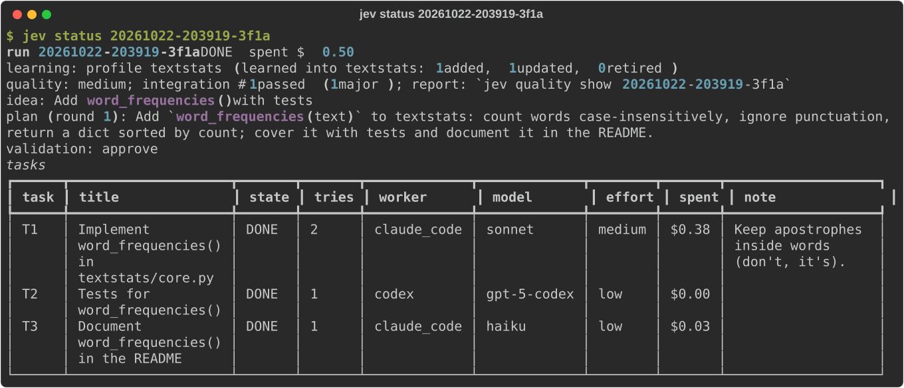</td>
  </tr>
  <tr><td colspan="2"><b>Jev decides; the Coding Decision Agent grades code</b><br>Jev picks agent, model and effort at every decision point; if a decision cannot be made confidently, the run stops for a human. The validator challenges every plan choice, a voted reviewer checks each task, and for code work the Coding Decision Agent grades diffs and routes coding tasks. With <code>primary = "jev"</code>, Jev answers alone with the rules dispatcher as fallback, and <code>jev log</code> says why. <a href="#how-it-works">The dispatcher</a></td></tr>
  <tr><td colspan="2">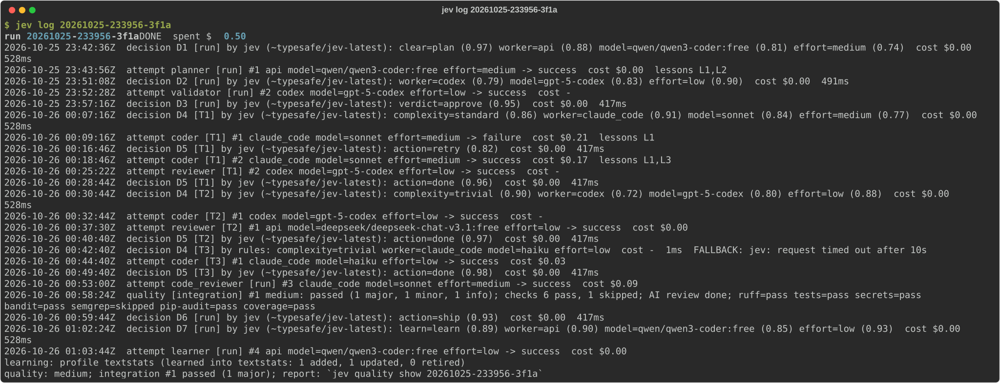</td></tr>
  <tr><td colspan="2"><b>Chat before you run</b><br><code>jev chat</code> asks which lessons to use, talks the idea through, writes a brief, then plans, runs or queues it. <a href="docs/chat.md">Chat</a></td></tr>
  <tr><td colspan="2">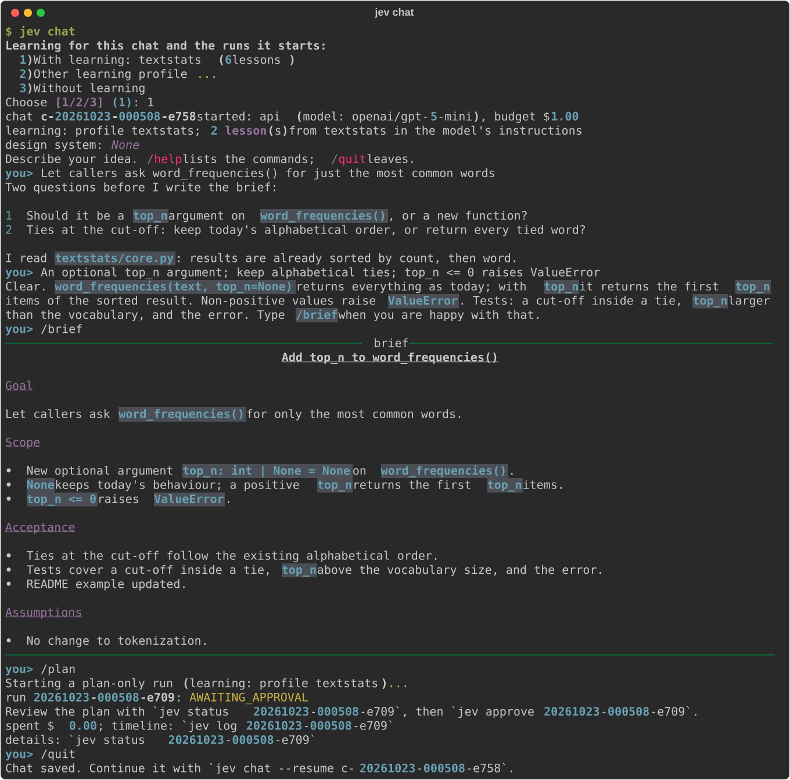</td></tr>
  <tr><td colspan="2"><b>Idea queue and scheduler</b><br>Queue ideas with a priority; the scheduler works through them one run at a time within a daily budget. <a href="docs/queue.md">Queue</a></td></tr>
  <tr>
    <td></td>
    <td>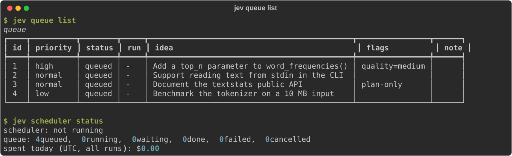</td>
  </tr>
  <tr><td colspan="2"><b>Kanban board</b><br><code>jev board</code> (or <code>--watch</code>, or the dashboard above) shows queued ideas and runs from Backlog to Done and Blocked. <a href="docs/queue.md">Board</a></td></tr>
  <tr><td colspan="2">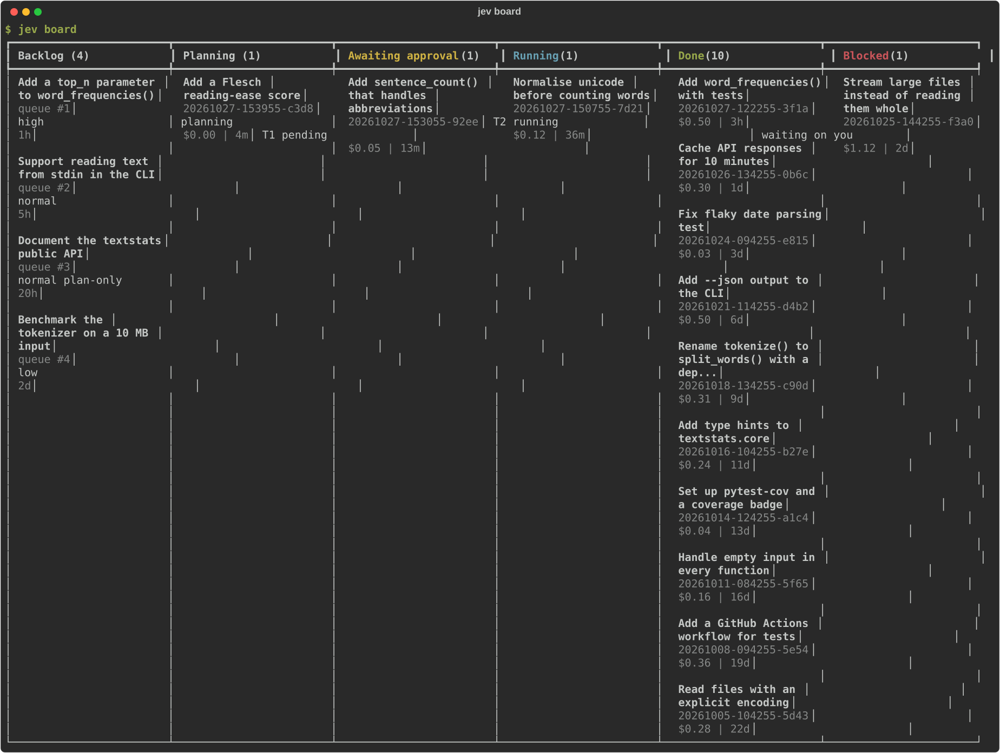</td></tr>
  <tr>
    <td><b>Free OpenRouter models</b><br>Plan and review on free models, with fallback to the next free or paid model on rate limits. <a href="docs/config.md#free-models">Free models</a></td>
    <td><b>Per-role MCP tools, skills and plugins</b><br>Define tools once, give them to roles by name; <code>jev doctor</code> checks them. Variable names only, never secrets. <a href="docs/config.md#agent-tools-tools">Tools</a></td>
  </tr>
  <tr>
    <td>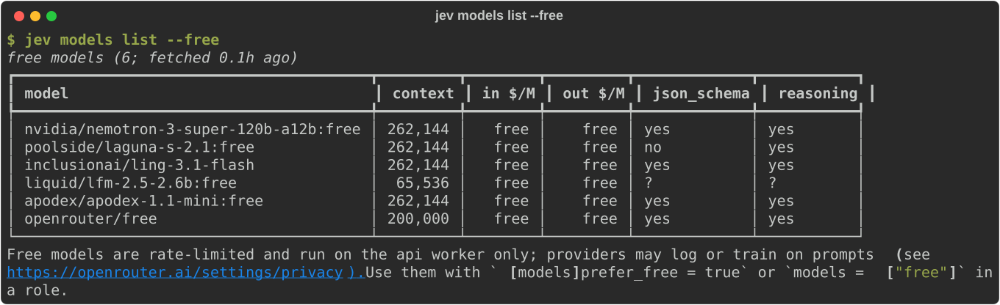</td>
    <td>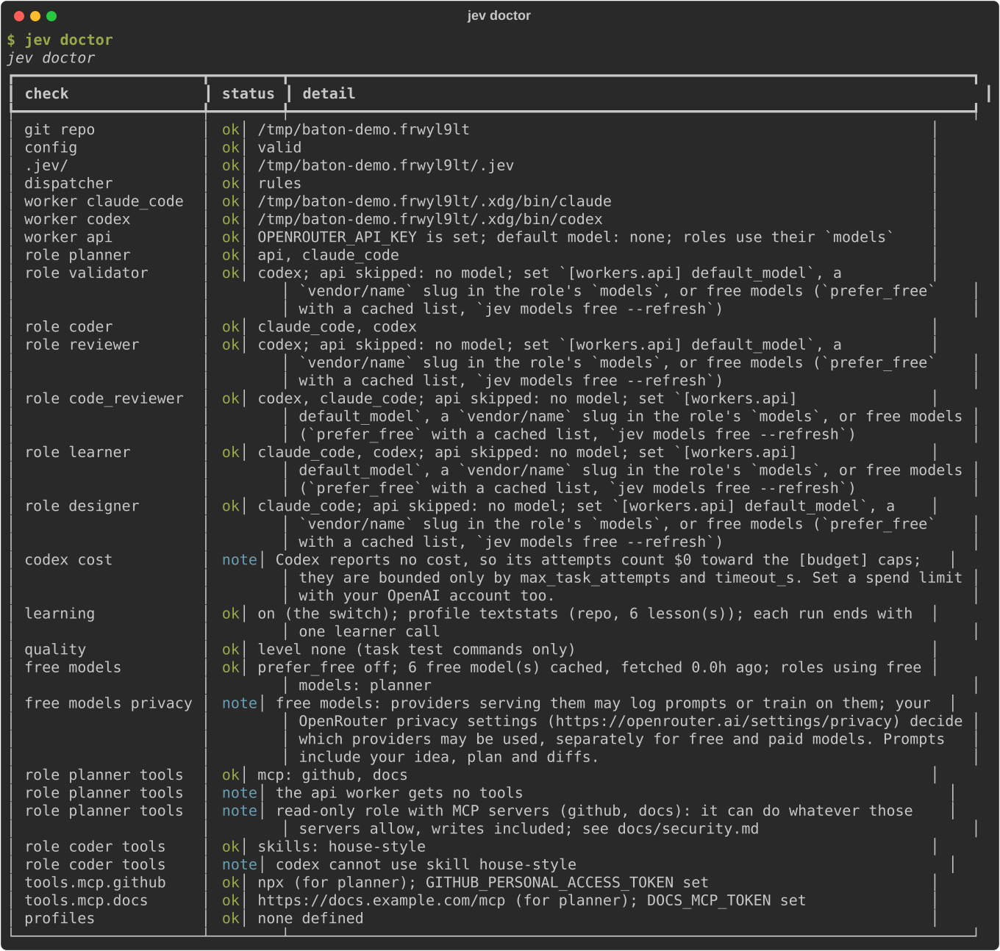</td>
  </tr>
  <tr><td colspan="2"><b>Recursive learning</b><br>A run that needed extra work ends with a learner call that turns mistakes into short lessons; later runs get the relevant ones in their prompts. <a href="docs/learning.md">Learning</a></td></tr>
  <tr>
    <td></td>
    <td>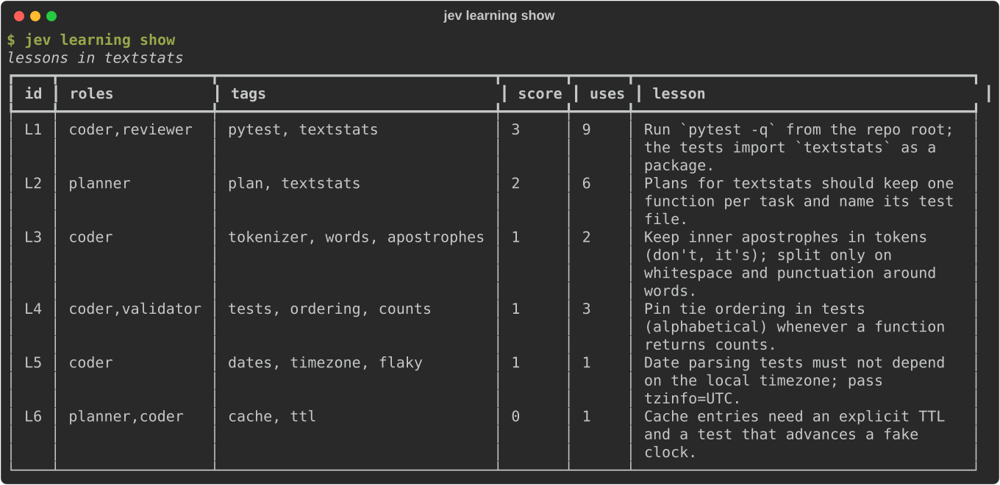</td>
  </tr>
  <tr><td colspan="2"><b>Quality and security gate</b><br>Levels from <code>basic</code> to <code>scalable</code>: lint, the full test suite, scanners and an AI code review with findings by severity; failing work is blocked and retried. <a href="docs/quality.md">Quality</a></td></tr>
  <tr>
    <td>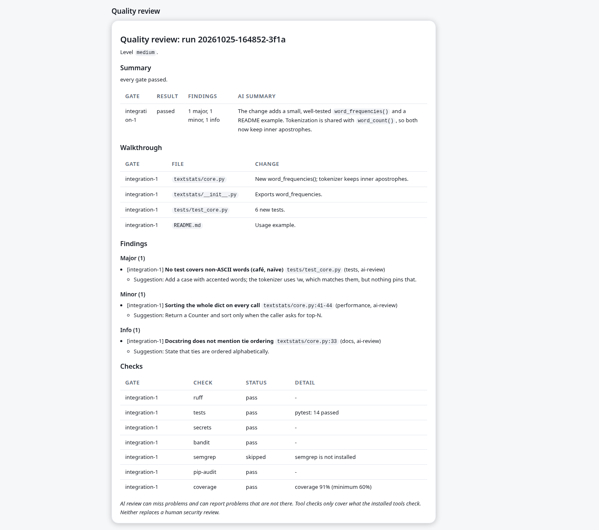</td>
    <td>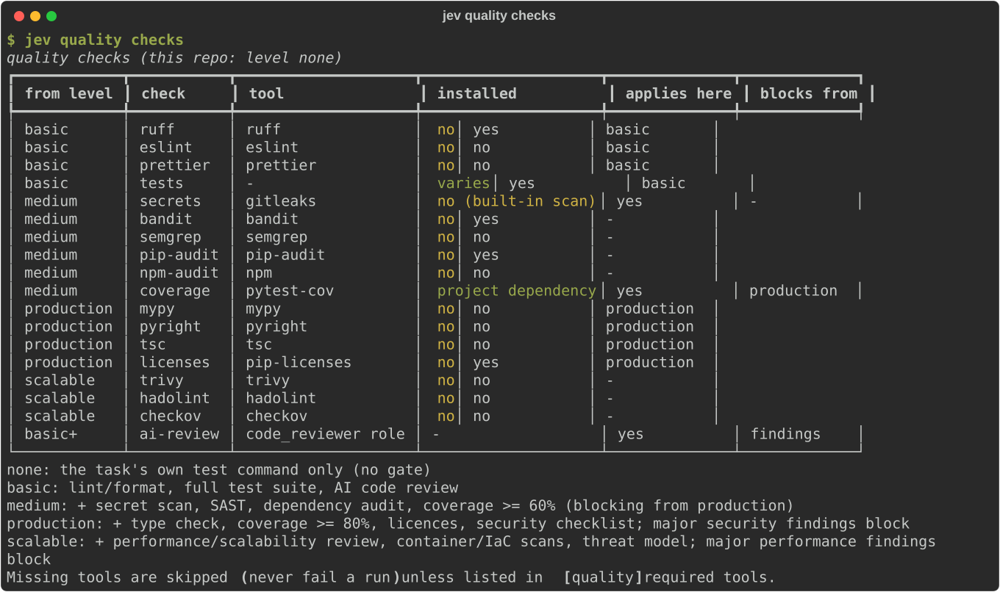<br>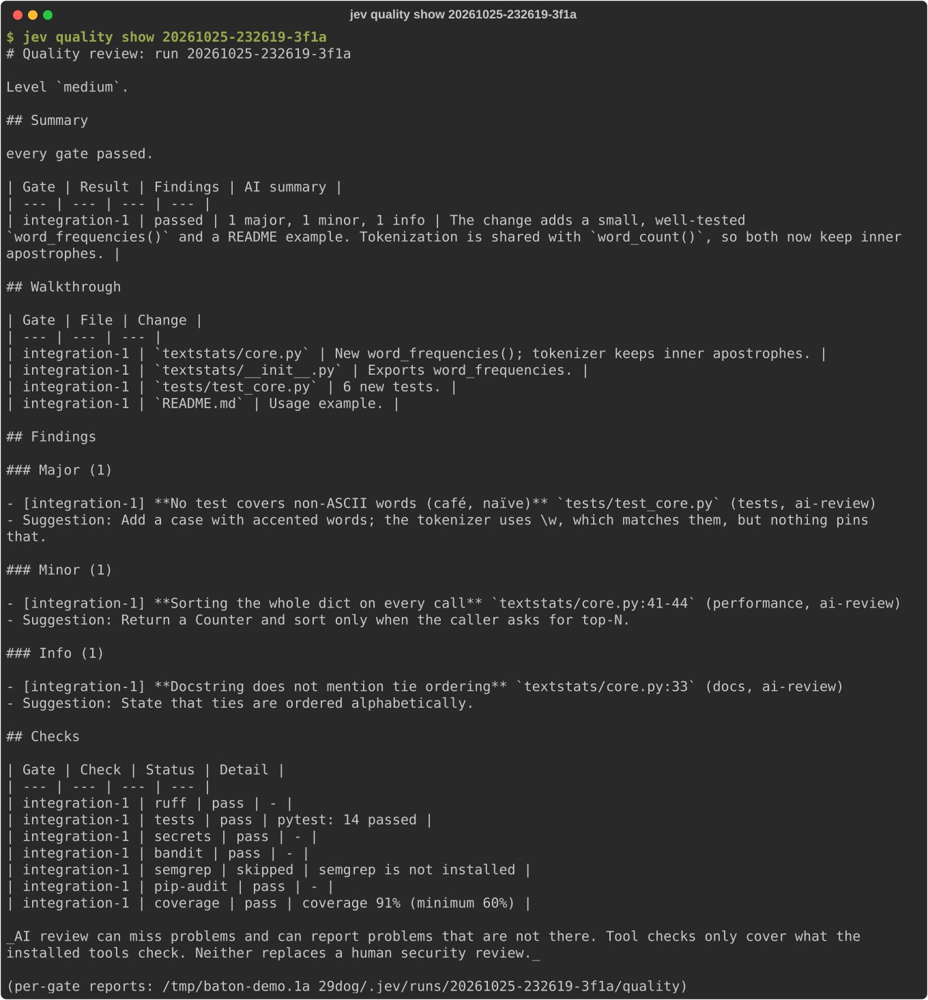</td>
  </tr>
  <tr>
    <td><b>Budgets and audit</b><br>Hard per-run and per-task caps; every decision and attempt is logged with its cost. <a href="#cost">Cost</a></td>
    <td><b>Isolated, local, dashboard</b><br>Each task in its own worktree and branch; nothing is pushed unless you ship a run. <code>jev dashboard</code> binds 127.0.0.1. <a href="#safety-defaults">Safety</a> · <a href="#dashboard">Dashboard</a></td>
  </tr>
  <tr><td colspan="2"></td></tr>
  <tr><td colspan="2"><b>Ship PRs and track KPIs</b><br>Opt-in <code>jev ship RUN</code> pushes a finished run's branch and opens a draft GitHub PR with your <code>gh</code> login (never force-pushes). With shipping on, a run Jev approves at D6 is merged once its checks pass, or waits for you to approve, modify or stop it. <code>jev kpi</code> and the KPIs page track cost, attempts, first-pass rate, fallbacks, time to merge and CI per PR, with trend charts and regression flags. <a href="#ship-prs-and-track-kpis">Ship and KPIs</a></td></tr>
  <tr>
    <td></td>
    <td>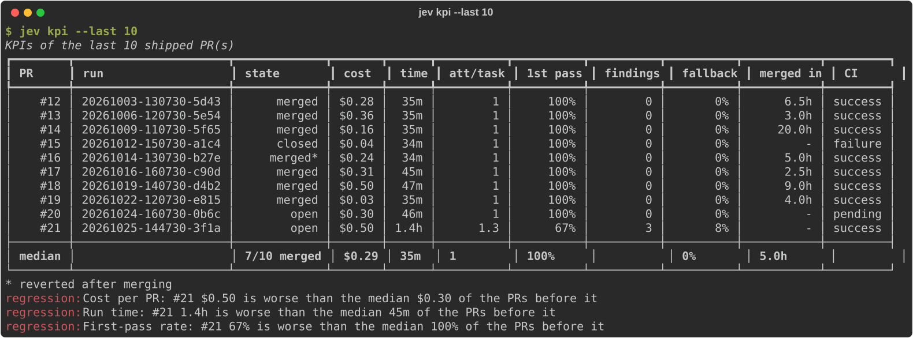</td>
  </tr>
  <tr><td colspan="2"><b>Servers, virtual browser and workspace profiles</b><br>Let agents check (<code>basic</code>, read-only) or maintain (<code>medium</code>: writes inside allowed paths, package installs, service restarts) your servers over SSH through jev's own policy-checked, audited MCP tools; give roles a pinned headless Playwright browser; pick servers, access and browser per run with <code>--profile</code>. <a href="#servers-browser-and-profiles">Servers</a></td></tr>
  <tr><td colspan="2"><b>Design systems</b><br><code>jev design new</code> walks you through six questions (purpose, app type, stack, brand) and saves a complete system — type-aware tokens, component docs, logo mark, favicons — into your library; <code>jev design reverse</code> extracts one from a URL or screenshots. <code>jev design list/use/clone/export/delete</code> manage the library, and the designer grounds UI work in the repo's stored system. <a href="docs/design.md">Design</a></td></tr>
</table>

## How it works

One idea is one **run**. The CLI is `jev`. The run moves through these states:

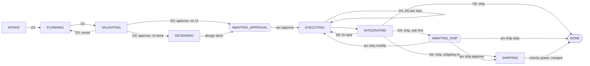

Any state can also end in `NEEDS_HUMAN`, `FAILED`, `BUDGET_EXCEEDED` or `CANCELLED`.

1. **Planning.** A planner agent splits the idea into small tasks (`T1`, `T2`, ...) with
   dependencies, acceptance criteria and a test command each.
2. **Validation.** A validator agent, by default from a different vendor than the planner,
   approves the plan or sends it back. At most `max_plan_rounds` rounds.
3. **Approval.** You read the plan (`jev status <run_id>`) and approve it (`jev approve`).
4. **Execution.** Tasks run one at a time, dependencies first. Each coder works in its own git
   worktree on a branch `jev/<run_id>/<task_id>`. After the coder, jev runs the task's test
   command. A failed task is retried, escalated to more effort or a stronger model, or given to
   another worker.
5. **Integration.** jev merges the task branches, in dependency order, into a local branch
   `jev/<run_id>/result` and runs the tests there. Failing tests can produce a fix task.
   With a quality level set, a quality gate (lint, scans, AI review) runs after each task and
   on the result branch ([Quality gate](#quality-gate)).

**The dispatcher.** At each decision point (D1 to D8) the harness sends the dispatcher a small
card (state plus allowed answers) and acts on the answer:

| Point | When | Decides |
| --- | --- | --- |
| D1 | Intake | Plan now or ask a human; planner worker, model, effort |
| D2 | After the plan | Validator worker, model, effort |
| D3 | After validation | Approve, revise, or ask a human |
| D4 | Each ready task | Complexity, coder worker, model, effort |
| D5 | After a task's tests (and review, quality gate) | Done, retry, escalate, reassign, or ask a human |
| D6 | After integration (and quality gate) | Ship, add a fix task, or ask a human |
| D7 | At the end of a run, if learning is on | Learn or skip; learner worker, model, effort |
| D8 | Before each task review | Reviewer worker, model, effort |

Jev, the main orchestrator, makes every decision; if a question cannot be settled confidently,
the run stops for a human (`jev resume` continues it). For code work, the Coding Decision Agent
(`S4MPL3BI4S/Coding_Decision_Agent`, opt-in via `[code_orchestrator]`) grades diffs at the
quality gate and routes coding tasks at D4, gated on calibrated confidence (0.7); every grade is
ledgered per agent/tier/skill (`<repo>/.jev/cda-ratings.jsonl`, Ratings tab on the Learning page),
and a blocked gate hands the next attempt a rework brief composed from the grade, the failed
checks and the AI review — see [docs/code-orchestrator.md](docs/code-orchestrator.md). With
`[dispatcher] primary = "jev"`, Jev answers alone and a deterministic rules dispatcher answers
any decision Jev cannot. `jev log` shows who made each decision and why a fallback happened. The harness
itself makes no routing choices; it only enforces hard limits (plan rounds, task attempts,
budgets).

**Roles and workers.** A role is a prompt template plus an output format
([docs/roles.md](docs/roles.md)). A worker is an agent that can play a role:

| Worker | What it is | Roles |
| --- | --- | --- |
| `claude_code` | Claude Code CLI (`claude -p`) | all |
| `codex` | Codex CLI (`codex exec`) | all |
| `api` | A model behind an OpenAI-compatible API, OpenRouter by default | all but the coder |

The reviewer stage is off by default.

## Requirements

- Python 3.11 or newer
- git
- [uv](https://docs.astral.sh/uv/)

Optional, depending on which workers and dispatcher you use:

- [Claude Code](https://docs.anthropic.com/en/docs/claude-code) CLI (`claude`)
- [Codex CLI](https://github.com/openai/codex) (`codex`)
- `OPENROUTER_API_KEY`: for Jev and for the `api` worker. Alternatively, `TYPESAFE_API_KEY` to
  call Jev directly at TypeSafe (see [docs/config.md](docs/config.md#dispatcherjev)).

You need at least one worker that can code (`claude_code` or `codex`). Without any key, set
`[dispatcher] primary = "rules"` and jev runs with the rules dispatcher.

## Install

Baton is not on PyPI yet. Install it from GitHub:

```bash
uv tool install git+https://github.com/Gane2506/baton
jev --version
```

Once it is published, this will be:

```bash
uv tool install baton-agent-orchestrator
```

The package installs the command `jev` and a long alias, `baton-agent-orchestrator`.

The web dashboard (`jev dashboard`) is an optional extra, so the CLI stays small:

```bash
uv tool install 'baton-agent-orchestrator[dashboard] @ git+https://github.com/Gane2506/baton'
# once on PyPI: uv tool install 'baton-agent-orchestrator[dashboard]'
```

**Docker** — run the dashboard as a container (see [docs/packaging.md](docs/packaging.md#docker)). Requires Docker and an existing git repo to serve, writable by uid 1000 inside the container; the image is the dashboard only (no worker CLIs inside):

```bash
docker run -d --name jev --restart unless-stopped -p 127.0.0.1:8765:8765 -e JEV_DASHBOARD_TOKEN="$(openssl rand -hex 24)" -v /srv/myproject:/data ghcr.io/gane2506/baton:0.5.0
docker logs jev   # the dashboard URL and access token
```

Or build it yourself: `docker build -t jev-dashboard .` (see [docs/packaging.md](docs/packaging.md)).

**Upgrading to v0.2.0.** The project was renamed to Baton Agent Orchestrator: the PyPI name is
now `baton-agent-orchestrator` and the long alias `jev-agent-orchestrator` is now
`baton-agent-orchestrator`. `jev`, its config and its state are unchanged. A uv tool installed
under the old name keeps that name, so reinstall it:
`uv tool uninstall jev-agent-orchestrator`, then install as above.

**Upgrading from v0.1.0**, where the command was `jao`: in each repo you set up, run
`jev init --migrate`. It renames `jao.toml` → `jev.toml` and `.jao/` → `.jev/`, updates
`.gitignore`, and renames local `jao/*` branches to `jev/*` (nothing is pushed). Until then,
every other command in that repo stops with this hint. Environment variables are now `JEV_*`
and the user config lives in `~/.config/jev/` (move `~/.config/jao/config.toml` and
`~/.local/share/jao/learning.db` yourself if you have them). Details:
[docs/decisions.md](docs/decisions.md).

## Quickstart

This walks through the sample repo in [examples/sample-repo](examples/sample-repo), a tiny
Python package with a passing test suite. Copy it out of this repository first; jev needs a git
repository of its own.

```bash
cp -R examples/sample-repo ~/textstats
cd ~/textstats
uv run pytest -q
git init && git add . && git commit -m "Initial commit"
```

**1. Create the config.**

```bash
jev init
```

This writes `jev.toml`, creates `.jev/` (state database, logs, worktrees) and adds `.jev/` to
`.gitignore`.

**Just exploring?** `jev init --demo` seeds the repo with made-up runs, queue items,
lessons and spend data, so you can try `jev board` and `jev dashboard` right away. The
data is clearly marked as demo (`.jev/demo.json`, plus a banner in the dashboard) and
`jev demo reset` removes it again. See [docs/demo.md](docs/demo.md).

**2. Edit `jev.toml`.** The defaults work. Two things you may want to change:

```toml
[dispatcher]
primary = "rules"      # "jev" (default) needs OPENROUTER_API_KEY; "rules" needs no key

[budget]
per_run_usd = 2.00     # hard cap for the whole run
per_task_usd = 0.50    # hard cap for one task
```

You can also list models per role under `[roles.<role>] models`. Empty lists mean "let the
worker use its default model". See [docs/config.md](docs/config.md) for every key.

**3. Check your setup.**

```bash
jev doctor
```

It checks git, the config, the dispatcher key, which worker CLIs are on `PATH`, and that every
role has a usable worker. Missing CLIs or keys are warnings; a role with no usable worker is an
error.

**4. Plan.**

```bash
jev run --plan-only "Add a word_frequencies(text) function with tests"
```

This runs planning and validation, then stops at `AWAITING_APPROVAL` and prints the run id.
Without `--plan-only`, `jev run` stops at the same gate anyway while
`[approval] require_plan_approval = true` (the default).

**5. Review the plan.**

```bash
jev status              # all runs
jev status <run_id>     # one run: plan summary, validation verdict, tasks
```

**6. Approve and execute.**

```bash
jev approve <run_id>
```

This runs every task and the integration step. It can take a while; each worker call has its
own timeout.

**7. Read the timeline.**

```bash
jev log <run_id>
```

Each line is a decision (point, dispatcher, answers, cost) or a worker attempt (role, worker,
model, effort, status, cost). Times are UTC (marked `Z`), like the run id. Raw, redacted
worker logs are in `.jev/runs/<run_id>/`.

**8. Look at the result.**

The result is the local branch `jev/<run_id>/result`. Each task also keeps its branch
`jev/<run_id>/<task_id>`. Nothing is pushed and your current branch is not touched.

```bash
git log --oneline jev/<run_id>/result
git diff HEAD jev/<run_id>/result
git merge jev/<run_id>/result      # when you are happy with it
```

Other commands:

```bash
jev resume <run_id>     # continue after a crash or Ctrl-C
jev cancel <run_id>     # stop a run; branches and worktrees are kept
```

A run that ends in `NEEDS_HUMAN`, `FAILED` or `BUDGET_EXCEEDED` keeps its branches and
worktrees for inspection. `jev status <run_id>` shows the reason. One `NEEDS_HUMAN` stop can be
continued: a broken custom prompt template; fix it, then `jev resume <run_id>`.

`jev run`, `jev approve` and `jev resume` exit with a code scripts can test, so
`jev approve <run_id> && jev ship <run_id>` never ships a run that stopped short:

| Exit code | Meaning |
|---|---|
| 0 | The run is `DONE`, `AWAITING_APPROVAL` or `AWAITING_SHIP` (or approved without workers, waiting for `jev resume`) |
| 1 | The command failed: unknown run, bad flag value, no usable worker, not a git repository |
| 2 | Usage error (unknown option, missing argument) |
| 3 | The run stopped short of `DONE`: `NEEDS_HUMAN`, `FAILED`, `BUDGET_EXCEEDED` or `CANCELLED`; `jev status <run_id>` says why |

To see the whole flow without any agent CLI or key, set `primary = "rules"` and prefix the
commands with `JEV_FAKE_WORKERS=1`. Scripted fake workers then plan one task and write a
placeholder file.

## Giving agents tools

Roles can get MCP servers, skills and Claude Code plugins, through config only. Define each tool
once under `[tools]`, then give it to roles by name:

```toml
[tools.mcp.github]
command = "npx"
args = ["-y", "@modelcontextprotocol/server-github"]
env_from = ["GITHUB_PERSONAL_ACCESS_TOKEN"]   # variable names only, never values

[tools.skills]
house-style = ".claude/house-style"           # a folder with SKILL.md

[roles.planner]
mcp = ["github"]

[roles.coder]
skills = ["house-style"]
```

Claude Code gets only the role's MCP servers (`--mcp-config` plus `--strict-mcp-config`), skills
and plugins for that run; Codex gets the MCP servers through `-c mcp_servers...` (it cannot take
skills or plugins per run); the API worker gets no tools yet. Nothing is installed or written to
your CLI config. A read-only role can do whatever its MCP servers allow, so prefer read-only
tokens there. `jev doctor` lists each role's tools and warns about unset variables. Details:
[docs/config.md](docs/config.md#agent-tools-tools) and [docs/security.md](docs/security.md).

## Learning from past runs

jev can learn from its own runs (off by default). With learning on, a run that needed extra
work ends with one more model call, the **learner**, which turns what went wrong into short
lessons; later runs get the relevant lessons in their prompts, and the learner refines or
retires old lessons as it goes. Lessons are kept per **profile**, in the repo (`.jev/`) or in
a shared database for all your repos.

```bash
jev learning enable                    # on for this repo, profile "default"
jev learning create work --shared      # a profile usable from every repo
jev learning use work                  # make it the active one
jev run --no-learning "quick fix"      # one run without lessons
jev learning show                      # what was learned; `forget L3`, `flush --yes`
```

Lessons stay on your machine (redacted before they are stored) and are sent only to your
configured workers, inside prompts. Details: [docs/learning.md](docs/learning.md).

## Quality gate

An optional CodeRabbit-style gate (off by default): after each task and on the result branch
it runs linters, the full test suite, scanners and an AI code review, writes a report, and
blocks work that fails. Levels are cumulative:

| Level | Adds |
| --- | --- |
| `basic` | lint/format, full test suite, AI code review |
| `medium` | secret scan, SAST, dependency audit, coverage >= 60% |
| `production` | type check, coverage >= 80%, licences, security checklist; major security findings block |
| `scalable` | performance/scalability review, container/IaC scans, threat model |

```bash
jev run --quality production "add password reset"   # or [quality] level = "..." in jev.toml
jev quality checks                                   # what is installed and applies here
jev quality show RUN                                 # Summary, Walkthrough, Findings, Checks
```

A blocked task is retried with the findings in the coder's prompt; a blocked integration gets
a fix task. Missing tools are skipped, never fatal. The AI review is one extra model call per
task attempt and per integration round, can be wrong, and is no substitute for a human security
review. Details: [docs/quality.md](docs/quality.md).

## Chat before you run

Talk an idea through first. The chat model asks clarifying questions, can read the repo
(read-only), and writes a short brief for the planner; then plan, run or queue it from the
chat:

```bash
jev chat                    # pick learning on the start screen, then describe the idea
# you> /brief   /plan   /run   /queue high   /learning off   /quality basic   /cost   /quit
jev chat --list             # saved chats; `jev chat --resume ID` continues one
```

It uses the api worker when its key is set, else Claude Code, and stops calling the model at
`--budget-usd` (default $1.00). Details: [docs/chat.md](docs/chat.md).

## Free models

OpenRouter serves some models for free. jev can use them for the roles that run on the `api`
worker (planner, validator, reviewer, learner when they list `api`); Claude Code and Codex,
and so the coder, are unaffected. The trade-off:

- **Cost:** free models cost $0, so runs that plan and review on them spend little.
- **Rate limits:** OpenRouter documents 20 requests per minute and 50 per day (1000 per day
  once you have bought 10 credits). When a free model hits a limit, jev tries the next free
  model, then the first paid model in the role's pool, then another worker.
- **Privacy:** providers serving free models may log or train on your prompts (your idea, the
  plan, diffs), depending on your [OpenRouter privacy settings](https://openrouter.ai/settings/privacy).

```toml
[models]
prefer_free = true                          # free models first, wherever api is allowed

[roles.planner]
workers = ["api", "claude_code"]
models = ["free", "openai/gpt-5-mini"]      # "free" = up to 3 cached free models, then paid
```

```bash
jev models free                             # free models, with json_schema/reasoning support
jev models list --supports json_schema      # every model that supports structured output
jev doctor                                  # shows which roles would use free models
```

Details: [docs/config.md](docs/config.md#free-models).

## Queue, scheduler and board

Queue ideas and let jev work through them one run at a time, then watch progress as a
kanban board:

```bash
jev queue add "add rate limiting" --priority high
jev queue add "document the loader" --plan-only
jev scheduler start --max-runs 5 --daily-budget-usd 10   # foreground; Ctrl-C to stop
jev board --watch                                        # Backlog ... Done, Blocked
```

Runs still stop for plan approval by default, so an unattended scheduler leaves each idea
`waiting` with a validated plan for you to `jev approve`. Details:
[docs/queue.md](docs/queue.md).

## Dashboard

A small web UI over the same state as the CLI, for one repo:

```bash
jev dashboard              # http://127.0.0.1:8765/, opens a browser (--no-open to skip)
```

- **Board**: the Kanban columns, refreshed every few seconds.
- **Run**: plan, validation, tasks, the decision timeline (with Jev's confidences and fallback
  reasons), attempts, learning, the quality review and log files; **Approve**, **Resume** and
  **Cancel** buttons (runs execute in the background, one at a time per run).
- **Queue** (add, reorder, remove; scheduler status), **Learning** (profiles and lessons),
  **Chats** (read-only transcripts), **Spend** (per run and per day), **KPIs** (shipped PRs and
  trends) and **Settings** (effective config, env var names, `jev doctor`).

Screenshots of every page are in [Features](#features) above and in
[docs/dashboard.md](docs/dashboard.md#screenshots).

It listens on 127.0.0.1 only. On a VPS keep it that way and use an SSH tunnel
(`ssh -L 8765:127.0.0.1:8765 host`). Any other `--host` requires a token, which jev generates
and prints. Details: [docs/dashboard.md](docs/dashboard.md).

## Ship PRs and track KPIs

Opt-in (`[ship] enabled = true` in `jev.toml`, plus the [GitHub CLI](https://cli.github.com)
logged in):

```bash
jev ship RUN_ID --dry-run   # the PR body and the exact commands, nothing run
jev ship RUN_ID             # push jev/RUN/result to jev/RUN, gh pr create (draft); asks first
jev ship sync --all         # read state, reviews, CI and merges back from GitHub
jev kpi --last 10           # per-PR KPIs, medians and regression flags (--json for scripts)
```

Only DONE runs whose quality gate passed are shipped. jev never force-pushes and never enables
auto-merge; branch protection still applies. With shipping on, a run Jev approves at D6
ships by itself: it is merged once its checks pass (`[ship] after_approval = "merge"`, the
default under consensus), or waits for `jev ship approve | modify | stop RUN` ("ask"). The dashboard run page has a
**Ship as PR** button and the **KPIs** page charts each KPI against its rolling median.
Details: [docs/ship.md](docs/ship.md).

## Servers, browser and profiles

```toml
[servers.web]
host = "web1"                 # ~/.ssh/config alias; key from ssh-agent, host key already known
access = "medium"             # "basic" = read-only commands
workdir = "/srv/app"
allowed_paths = ["/srv/app"]

[profiles.prod]
servers = ["web"]
access_overrides = { web = "basic" }   # may only lower
```

```bash
jev doctor --connect                       # check ssh login (BatchMode, strict host keys)
jev run "why are we serving 502s?" --profile prod
jev profile list | show prod | use prod    # repo default: .jev/profile
jev browser install --dry-run              # pinned Playwright Chromium; asks before running
```

Agents never get raw SSH: they call `list_servers`, `run_command`, `read_file` (and at medium
`write_file`, `upload`) on jev's MCP server, which checks every command against the access
level and an always-blocked list (reboots, disk formatting, user/firewall changes,
`rm -rf /`, `curl | sh`, `git push --force`, ...) and logs it to `.jev/audit/servers.log`.
Every role but the coder is capped at `basic`. `access = "full"` is not available yet.
Details, including the allow/deny tables and a VPS browser setup: [docs/servers.md](docs/servers.md).

## Safety defaults

- Coder tasks run in separate git worktrees under `.jev/worktrees/`, never on your branch.
- jev never runs `git push`, except to ship a run (opt-in `[ship] enabled`, never `--force`;
  it merges only a PR Jev approved at D6, once its checks pass).
- The planner, validator and reviewer get read-only access. The `api` worker has no file
  access at all.
- Claude Code's coder may only use read and edit tools plus `git status` and `git diff` unless
  you allow more. Codex's coder runs in its `workspace-write` sandbox.
- Flags that skip permission prompts are off and opt-in only; `jev doctor` warns when one is on.
- Keys come only from environment variables, never from config files. Logs are redacted.
- Servers are reached only through jev's policy-checked, audited tools (`basic` read-only or
  `medium`); SSH runs with `BatchMode=yes` and `StrictHostKeyChecking=yes`.
- Run jev only on repositories you trust: agent CLIs load project files such as `CLAUDE.md`
  and hooks.

Read [docs/security.md](docs/security.md) before your first real run, including the note on
using subscription logins for automated work.

## Cost

Every run has hard caps that the harness enforces whatever the dispatcher says:
`[budget] per_run_usd` (default $5.00) and `per_task_usd` (default $1.50). Once a cap is spent,
no new worker starts; work already running finishes, so the total can end slightly above a cap.
The run then stops in `BUDGET_EXCEEDED` (run cap) or `FAILED` (task cap). Claude Code also gets
its own per-attempt cap (`--max-budget-usd`).

Dispatcher calls count toward the budget. Jev charges for input tokens only, a small fraction
of a cent per decision. Costs reported by the CLIs are their own estimates; on a subscription
login they are not real spend. Codex reports no cost, so its attempts count as $0 against the
caps: jev's budget does not limit Codex spend, only `max_task_attempts` and the Codex
`timeout_s` do (`jev doctor` notes this). Use your provider's own spend limits as well.
`jev status` and `jev log` show what each run spent.

## Documentation

- [docs/config.md](docs/config.md): every config key, layering, environment variables
- [docs/roles.md](docs/roles.md): the roles, their inputs and outputs, custom prompts
- [docs/learning.md](docs/learning.md): learning profiles, lessons, privacy and cost
- [docs/quality.md](docs/quality.md): the quality and security gate, levels, tools, reports
- [docs/queue.md](docs/queue.md): idea queue, scheduler and kanban board
- [docs/chat.md](docs/chat.md): talking an idea through before a run
- [docs/dashboard.md](docs/dashboard.md): the web dashboard and its security model
- [docs/demo.md](docs/demo.md): `jev init --demo` demo projects and `jev demo reset`
- [docs/ship.md](docs/ship.md): `jev ship` pull requests, `jev kpi` and the benchmarks
- [docs/servers.md](docs/servers.md): servers over SSH, access levels, audit log, browser, profiles
- [docs/security.md](docs/security.md): isolation, permissions, keys, terms of use
- [docs/decisions.md](docs/decisions.md): design decisions and deviations from the plan
- [CHANGELOG.md](CHANGELOG.md): what changed in each release
- [PLAN.md](PLAN.md): the original design and milestones
- [CONTRIBUTING.md](CONTRIBUTING.md): development setup and guidelines

## Development

```bash
git clone https://github.com/Gane2506/baton
cd baton
uv sync --all-extras
uv run jev --version
uv run pytest
uv run ruff format --check . && uv run ruff check . && uv run mypy
```

Tests never touch the network or a real agent CLI. Live smoke tests in `tests/live/` call real
services or CLIs and cost money; they are skipped unless you set `JEV_LIVE_TESTS=1` and provide
the needed keys or CLIs:

```bash
JEV_LIVE_TESTS=1 OPENROUTER_API_KEY=... uv run pytest tests/live
```

See [CONTRIBUTING.md](CONTRIBUTING.md) for the project layout and how to add a worker or change
a role prompt.

## Contributing

Contributions are welcome. Read [CONTRIBUTING.md](CONTRIBUTING.md) first: how to pick an issue,
how review works, and the checks to run before you open a pull request:

```bash
uv run ruff format . && uv run ruff check . && uv run mypy && uv run pytest -q
```

Participation follows the [Code of Conduct](CODE_OF_CONDUCT.md). Report security problems
privately as described in [SECURITY.md](SECURITY.md), not in a public issue.

## License

Apache-2.0. See [LICENSE](LICENSE).
