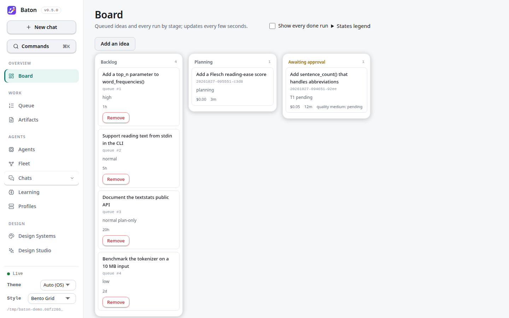
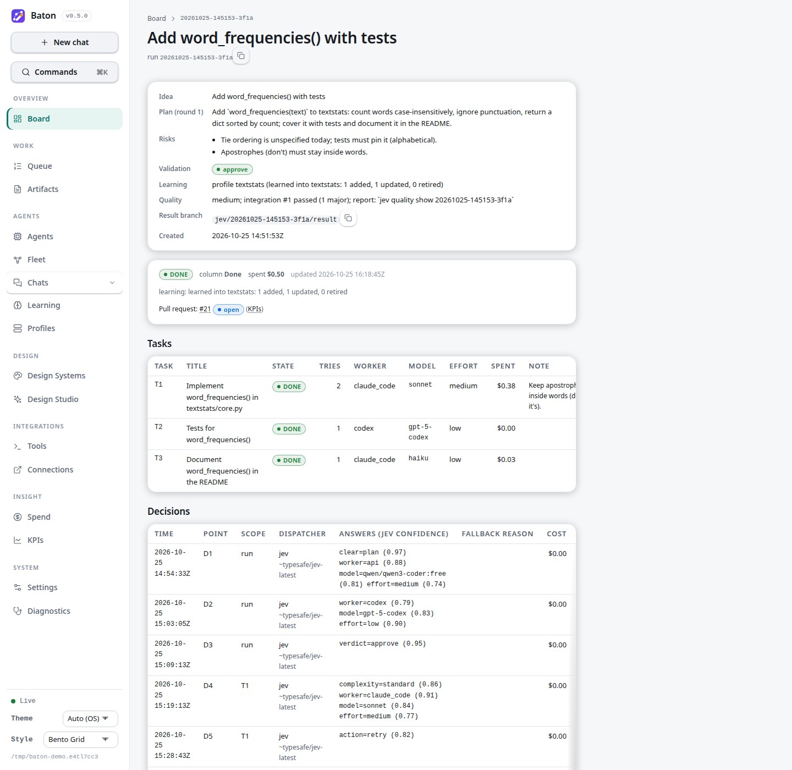
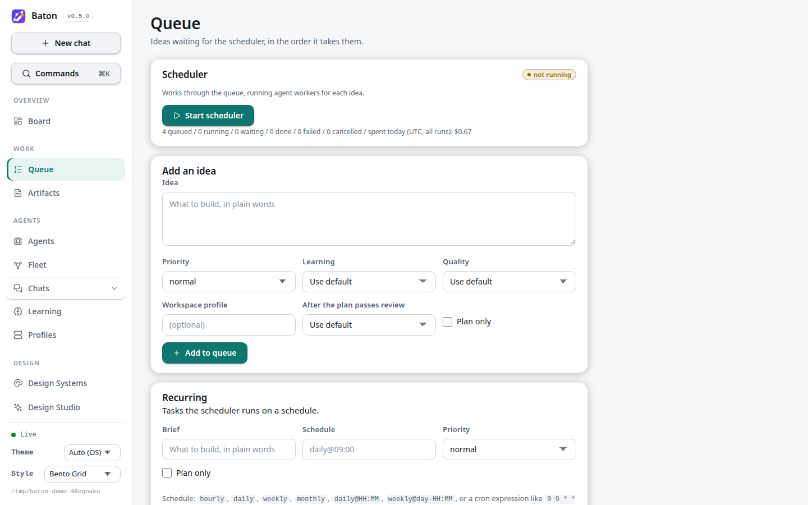
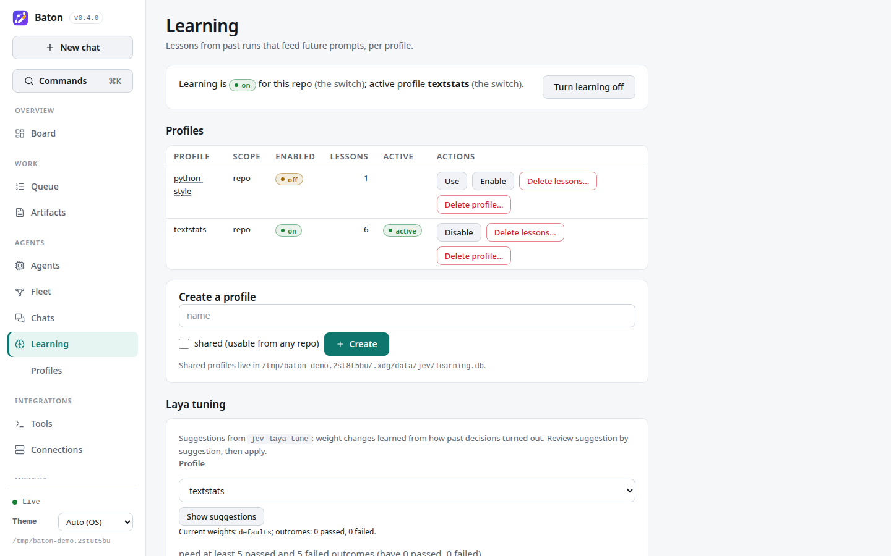
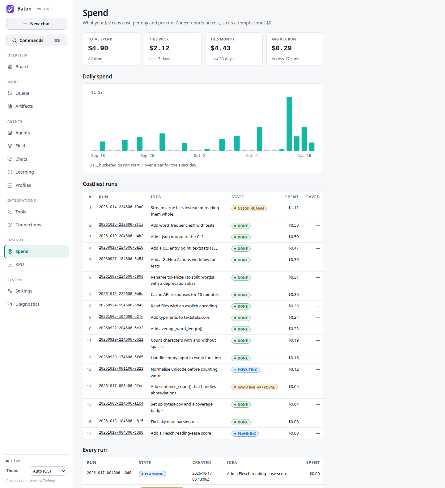
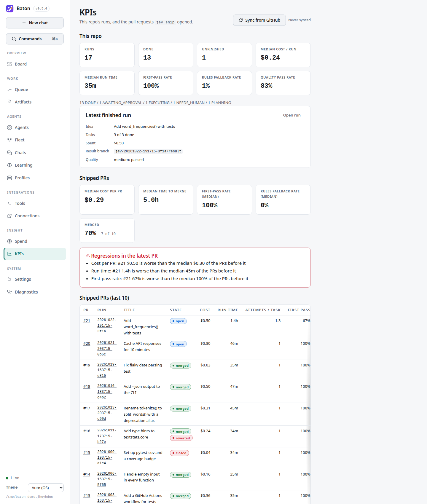
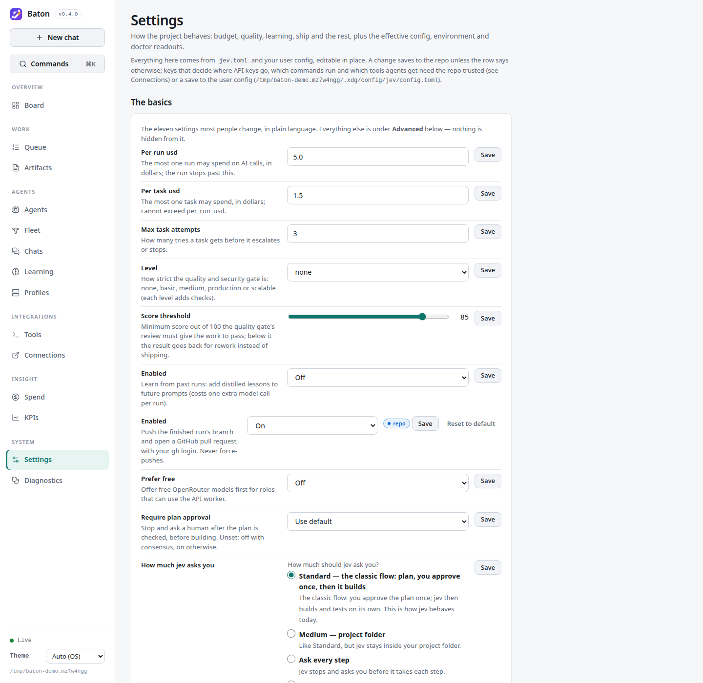

# Web dashboard

`jev dashboard` serves a small web UI for one repository. It reads the same `.jev/state.db`,
lesson profiles, chat folders and run logs as the CLI, and its buttons call the same functions
as the CLI commands, so anything you do in the browser is exactly what the matching `jev`
command would do.

## Install

The dashboard is an optional extra (Starlette, uvicorn, python-multipart and markdown-it-py),
so the CLI stays small when you do not need it:

```bash
uv tool install 'baton-agent-orchestrator[dashboard] @ git+https://github.com/Gane2506/baton'
# once the package is on PyPI:
uv tool install 'baton-agent-orchestrator[dashboard]'
```

Without the extra, `jev dashboard` exits with that install hint. In a clone of this repo,
`uv sync --all-extras` installs it.

## Running it

```bash
jev dashboard                       # http://127.0.0.1:8765/ and opens a browser
jev dashboard --no-open --port 9000 # another port, no browser
jev dashboard --repo ../other-repo  # any path inside the target git repo
```

| Option | Default | Meaning |
| --- | --- | --- |
| `--repo PATH` | `.` | A path inside the git repo to show. |
| `--host HOST` | `127.0.0.1` | Address to listen on. Anything but loopback needs a token (below). |
| `--port PORT` | `8765` | Port. |
| `--open / --no-open` | `--open` | Open the URL in a browser after start. |
| `--token TOKEN` | generated off loopback | Access token, at least 16 characters. Also read from `JEV_DASHBOARD_TOKEN`. |

Ctrl-C stops the server. Before it exits, it cancels every approve or resume job it started
and waits for it (up to 30 s per job): the job's agent process is stopped, like Ctrl-C on
`jev approve`, and the run keeps its saved state; continue it with `jev resume <run>` (or the
Resume button). A Ship job cannot be cancelled mid-step; shutdown waits for it.

## Pages



- **Board** (`/`): the `jev board` columns (Backlog, Planning, Awaiting approval, Running, Done,
  Blocked). Cards show the idea, run id, current task and its state, spend, age and the quality
  gate status. Refreshes every few seconds. `?all=1` shows every done run.
- **Run** (`/runs/<id>`): idea, plan summary and risks, validation verdict, tasks, the decision
  timeline (point, dispatcher and model, answers with Jev's confidences, fallback reason, cost,
  latency), attempts (role, worker, model, effort, status, cost, lessons injected, log link),
  learning outcome, the quality review (`review.md`, rendered as sanitized HTML), the result
  branch name, and every file under `.jev/runs/<id>/` (served read-only as plain text).
  Buttons:
  - **Approve and run** for a run awaiting approval (`jev approve`).
  - **Resume** for an interrupted run or a NEEDS_HUMAN run with a resume point (`jev resume`).
    When another jev process may still be running the run, the page shows **Force resume**
    instead, with the reason, and a plain resume is refused: resuming would start a second
    pipeline on the same worktrees and double the spend. The signs are an attempt without a
    result that started less than its worker's `timeout_s` plus 5 minutes ago (an older one is
    from a process that died), or a live scheduler lock whose current queue item started this
    run, or a live run lease held by another process (see below). Force resume asks for
    confirmation; use it only when that process is gone. It cannot override a live lease: the
    job then fails with "run ... is in use".
  - **Cancel** for any unfinished run (`jev cancel`; branches and worktrees are kept).
  - **Ship as PR** for a DONE, not yet shipped run when `[ship] enabled = true` (`jev ship`,
    [ship.md](ship.md)): a confirmation page shows the remote, branch, base, title and the
    rendered PR body; confirming pushes and opens the PR in the background, and the run page
    then links it.

  Approve and resume run in a background thread through the same code path as the CLI
  (config, workers and pipeline are built the same way), so the web server stays responsive;
  the page shows the job's status and the run's progress live. Only one job per run id runs at
  a time; a second click is refused. Across processes, the run lease in the state DB
  (issue #61) keeps a terminal `jev resume`, `jev approve` or the scheduler from driving the
  same run at the same time: whichever starts second fails with "run ... is in use by another
  jev process".
- **Queue** (`/queue`): items in scheduler order with their effective status and flags; add an
  idea (priority, plan only, learning profile or none, quality level, workspace profile name),
  move an item to the top, up or down, remove it; scheduler status (lock holder, current item,
  queue counts, spend today). The scheduler itself is started from a terminal
  (`jev scheduler start`).
- **Learning** (`/learning`): the repo switch and active profile, profiles (scope, enabled,
  active, lesson count) and each profile's lessons. Actions: create (repo or shared), use,
  enable / disable (the repo or one profile), forget a lesson, and flush a profile, which asks
  for confirmation on a separate page first.
- **Chats** (`/chats`): saved `jev chat` sessions and their transcripts, read-only.
- **Spend** (`/spend`): spend per day for the last 30 days and the costliest runs, as
  server-rendered SVG bar charts, plus every run's spend.
- **KPIs** (`/kpis`, `?last=N`, default 20): PRs opened by `jev ship` with their KPIs (cost,
  run time, attempts per task, first-pass rate, findings, CI, time to merge), summary cards
  (median cost per PR, median time to merge, first-pass rate, fallback rate, merged share),
  regressions in the latest PR, and one server-rendered SVG trend chart per KPI with its
  rolling median and red regression points. Without shipped PRs it explains `jev ship`. See
  [ship.md](ship.md).
- **Settings** (`/settings`): a list of sections on the left (sticky on wide windows) and an
  editor for common settings in this repository's `jev.toml`: `[dispatcher] primary`, the
  budgets (`per_run_usd`, `per_task_usd`, `max_task_attempts`), `[approval]
  require_plan_approval`, `[review] enabled`, `[quality] level`, `[ship] enabled` and
  `after_approval`, `[learning] enabled` and `profile`, `[models] prefer_free`, and each
  role's `workers` and `models`. Each field shows where its value comes from (default, user
  config or `jev.toml`); **reset** removes the key from `jev.toml`, so the user config or the
  default applies again. **Review changes** checks the new file exactly as `jev` loads it
  (schema, your user config, trust) and shows a unified diff; nothing is written until you
  confirm, and an invalid value comes back on its field with nothing written. Confirming
  writes `jev.toml` atomically, keeping its comments and layout, and only if the file has not
  changed since the diff was shown (otherwise you get the new diff). The server rebuilds the
  file from these fields on every step: a request can never write a guarded key
  ([security.md](security.md)), `[trust]` or your user config. Below the editor, read-only: the
  effective config, the environment variables the config names with whether each is set (names
  only, never values), and the `jev doctor` checks (local checks only).

Pages follow your OS light/dark setting and work on narrow screens. Nothing is loaded from
other origins: no CDN, no web fonts, no analytics. The only script is a small vendored
`static/live.js` for the live regions and confirmation prompts; without JavaScript every page
still works (reload to refresh).

| Run | Queue |
| --- | --- |
|  |  |
| **Learning** | **Spend** |
|  |  |
| **KPIs** | **Settings** |
|  |  |

The Board in dark mode: [images/dashboard-board-dark.png](images/dashboard-board-dark.png).

## Security

The dashboard can approve runs, which start agents that edit code and spend money, so treat
access to it like shell access to the repo.

- **Loopback by default.** It binds `127.0.0.1`. On loopback it also checks the `Host`
  header (only `127.0.0.1`, `localhost` and `::1` are accepted), so a malicious web page
  cannot reach it through DNS rebinding.
- **Token off loopback.** Any other `--host` (for example `0.0.0.0`) requires a token: pass
  `--token` / set `JEV_DASHBOARD_TOKEN`, or jev generates a random one. jev prints the URL with
  `?token=<token>` and a warning. Every request (pages, files, static assets) must carry the token,
  as the `jev_token` cookie, an `X-Jev-Token` header, or the `token` query parameter; opening
  the printed URL swaps the query parameter for an HttpOnly, SameSite=Strict cookie and
  redirects to a clean URL. You can also pass `--token` on loopback to require it there.
- **Plain HTTP.** The server speaks HTTP, not HTTPS. Off loopback, the token and everything
  you see cross the network unencrypted unless you put a TLS proxy in front.
- **CSRF.** Every action is a POST (GETs never change anything). Each POST must come from the
  same origin (`Sec-Fetch-Site`, `Origin` or `Referer` must match) and carry a per-session
  form token (an HMAC of the session cookie with a secret that changes on every start).
  Restarting the dashboard makes old forms stale; reload the page.
- **Escaping.** Templates autoescape everything: ideas, plans, model answers, lesson text,
  transcripts. The quality review is Markdown rendered with raw HTML disabled (tags are shown
  as text) and unsafe link targets (`javascript:` and similar) refused.
- **Headers.** A strict Content-Security-Policy (`default-src 'self'`, no inline script or
  style, `frame-ancestors 'none'`), `X-Frame-Options: DENY`, `nosniff`, `Cache-Control:
  no-store`.
- **Files.** Only regular files strictly inside `.jev/runs/<run_id>/` are served, as
  `text/plain`; `..`, absolute paths, encoded traversal and symlinks pointing out are refused.
  Run logs are already redacted when written.
- **No secrets.** The config cannot hold secrets (secret-looking keys are rejected); the
  Settings page lists environment variable names and whether they are set, never values.

### On a VPS: use an SSH tunnel

Keep the default bind address and tunnel the port over SSH:

```bash
# on the server
jev dashboard --no-open --repo ~/src/myproject

# on your laptop
ssh -L 8765:127.0.0.1:8765 user@host
# then open http://127.0.0.1:8765/
```

The traffic is encrypted by SSH, nothing listens on a public interface, and no token is
needed. If you must bind a public address, use a long token, a firewall rule limiting who can
connect, and preferably a TLS reverse proxy.

## Screenshots

The screenshots here and in the README use made-up demo data, written straight into a scratch
repo's `.jev/` by [`examples/demo/seed_demo.py`](../examples/demo/seed_demo.py); no agent or
model runs. The seed script also sets the demo's `jev.toml` up for the pictures (rules
dispatcher, free models for the planner, example MCP servers and a skill, variable names only),
caches a model list from the test fixtures and saves one chat.

Every image in `docs/images/` except the logos comes from the running app on your checkout.
One command regenerates all of them:

```bash
uv sync --all-extras
uv run python examples/demo/screenshots.py              # writes docs/images/
uv run python examples/demo/screenshots.py --out preview/ --no-cli   # dashboard only, elsewhere
```

[`screenshots.py`](../examples/demo/screenshots.py) builds a scratch repo under `/tmp` from
`examples/sample-repo`, runs `jev init` and the seed script, starts the real `jev dashboard`
on a free loopback port and captures each `dashboard-*.png` with headless Chrome through
Playwright (a fresh browser profile, no proxy). It then runs `capture.py` for the terminal
images and deletes the scratch repo (`--keep` keeps it). Chrome is Playwright's own Chromium
when it is installed (`uv run playwright install chromium`), otherwise your Chrome; `--chrome
PATH` picks a binary.

Everything runs with a scrubbed environment (scratch HOME and XDG directories inside the demo
repo, `JEV_FAKE_WORKERS=1`, proxy variables pointing nowhere), so your own config, keys and
browser profile are never read. The seed script trusts the demo repo (`[trust] repos`) in that
scratch user config only and refuses to write any other.

**Terminal images** (`docs/images/cli-*.svg`): [`capture.py`](../examples/demo/capture.py)
runs the real `jev` commands in the demo repo with stub `claude`/`codex`/`npx` on `PATH` that
are never run, and exports the output with Rich's `export_svg`. `jev doctor` gets placeholder
values for the variables the demo config names; they are never printed, and the script refuses
to write an image that contains a home path or a placeholder. `jev chat` is driven from a
script with a canned model (`seed_demo.DemoChatBackend`); its `/plan` starts a real plan-only
run with fake workers, so the chat is captured last.

**In CI**, the `screenshots` job runs the same command on every pull request and uploads the
images as the `screenshots` artifact: a preview of the pull request's dashboard and CLI, and a
failure if the seed script or a page no longer renders. A pull request that changes what the
dashboard or the CLI shows commits the regenerated images (CONTRIBUTING.md).
